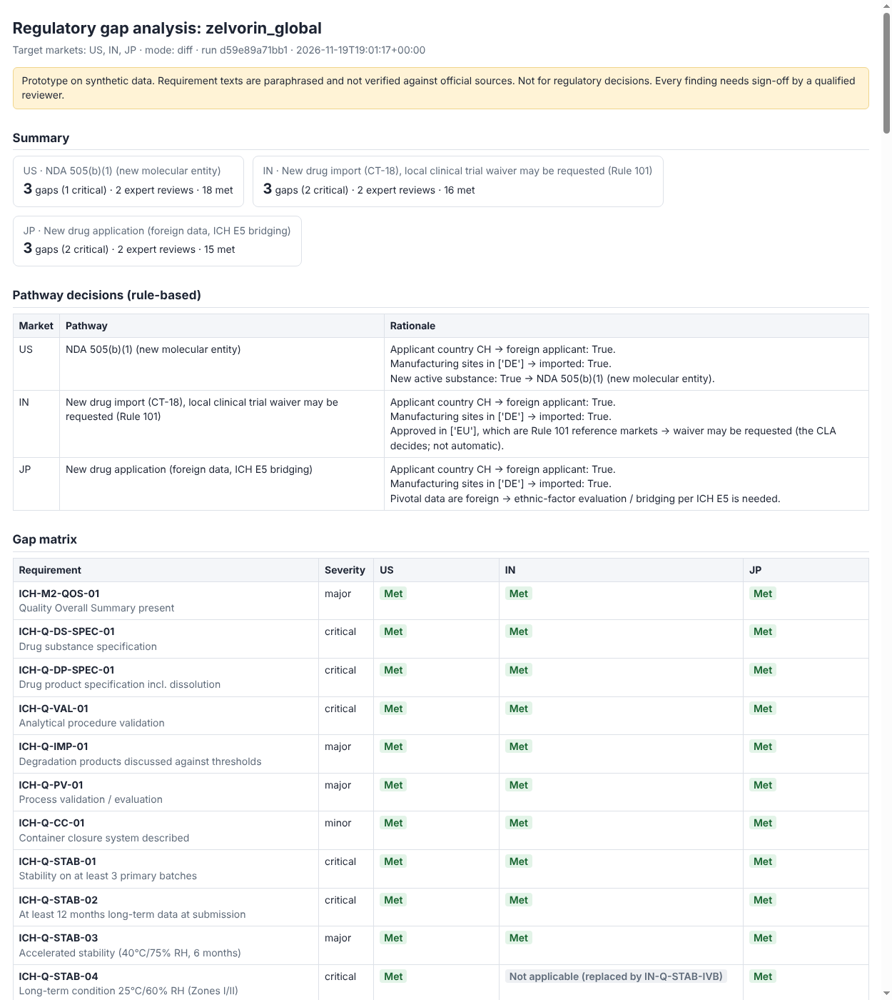
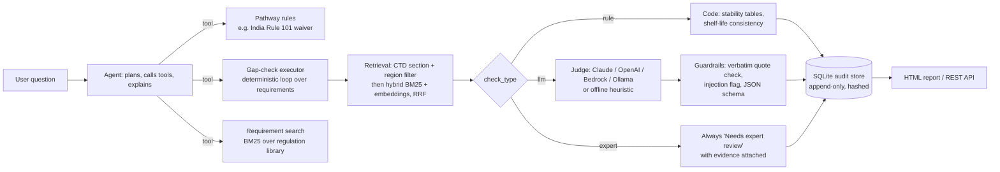

# Pharma Regulatory Gap Agent

**Question it answers:** *"Our drug is approved in the EU. What is missing from the dossier before we can file in the US, India and Japan?"*

The tool checks a CTD dossier against a library of regulatory requirements for each target market. It returns a gap matrix (requirement × market) where every verdict carries a verbatim dossier quote and the regulation it comes from. An agent on top answers questions in plain language, using only the checker's results.

> ⚠ Prototype on **synthetic data** (a fictional drug, "Zelvorin"). Requirement texts are my own paraphrases, marked `verified: false`. Not for regulatory use.



## Key idea: one ICH core + a thin overlay per market

CTD Modules 2–5 are largely harmonised through ICH. Most launch gaps sit in a few places: regional Module 1 (forms, labels, local agents), climatic-zone stability, local clinical / bridging data and local pharmacopoeia. So:

- `data/requirements/ich_core.yaml`: checked **once**, inherited by every market.
- `us_fda.yaml`, `in_cdsco.yaml`, `jp_pmda.yaml`: market overlays. An overlay can **override** a core item. Example: India replaces the 25°C/60% RH long-term condition with Zone IVb, 30°C/75% RH.
- **Diff mode** checks only the delta. On the eval set it needs 56 judge calls instead of 92 (**−39%**) and gives identical verdicts (enforced by a test).

## Architecture



Design rules I followed:

1. **The LLM never decides what to check.** Requirements are the outer loop, so nothing gets skipped. The agent plans and explains, but verdicts come only from the executor.
2. **Arithmetic and lookups go in code, not the LLM.** Batch counts, months of data, temperature/RH and label-vs-stability shelf life are all handled by `rules.py`.
3. **Every Met/Partial needs a verbatim quote.** If the quote isn't found in the cited chunk, the verdict is downgraded to *Needs expert review* (`guardrails.verify_quote`).
4. **Dossiers are untrusted input.** The global dossier contains a planted prompt-injection string. It gets flagged, and it cannot change verdicts.
5. **Module 1 is regional.** An EU application form can never satisfy the US Form 356h check (tested).
6. **Data classification gate.** Dossiers not marked `public-synthetic`/`non-sensitive` cannot be sent to external APIs. They must use Ollama or the offline checker (`llm.make_llm`).
7. **Audit trail.** Each run stores model, config hash, corpus hash, tokens and timing. SQLite triggers block UPDATE/DELETE, and a content hash detects tampering.

## Mapping to the DSAI Early Career – AI Engineering JD

| JD item | Where in this repo |
|---|---|
| AI agents, tool/function calling, multi-step workflows, state, guardrails | `agent.py`: 5 tools, a tool loop for Claude/OpenAI/Bedrock, step limit, argument validation, per-conversation run memory, grounding check on the final answer |
| RAG: grounding, retrieval quality, source/citation handling | `retrieval.py` (BM25, embeddings, RRF hybrid, metadata filter), `judge.py`, `guardrails.verify_quote` |
| Prompts, retrieval patterns, systematic improvement | `JUDGE_SYSTEM` prompt, retrieval ablation (`eval/eval_retrieval.py`), keyword → heuristic → LLM judge ladder |
| Evaluation: test cases, error analysis, regression testing, safety testing | `eval/eval_gaps.py` (gap recall/precision, confusion matrix, list of misses), CI gate on gap recall, injection and hallucinated-quote tests |
| Claude models, OpenAI models, AWS Bedrock | `llm.py`: `AnthropicLLM`, `OpenAILLM`, `BedrockLLM` (Converse API), `OllamaLLM`; one neutral message format |
| Python, REST APIs, SQL, Git, testing, CI/CD, observability | FastAPI (`api.py`), SQLite + SQL aggregates (`audit.py`), 34 pytest tests, GitHub Actions, JSON request logs, `/metrics`, token/latency stats per run |
| Package and deploy | `Dockerfile` (non-root, healthcheck), `docker-compose.yml` (+ optional local Ollama), CI builds and smoke-tests the image |
| Responsible AI, privacy, security, governance | classification gate, human sign-off by design (`expert` checks), immutable audit log, "unverified" banner, untrusted-input handling |
| Copilot Studio / Power Automate | The REST API exposes OpenAPI at `/openapi.json`, which can be imported as a custom connector (not built here) |

## Quickstart

```bash
pip install -e ".[anthropic,openai,bedrock,dev]"
pytest -q                                            # 34 tests, no network needed
gapagent check zelvorin_global --markets US,IN,JP    # gap matrix + HTML report in reports/
gapagent ask "What blocks a launch in India and Japan?" --trace
gapagent serve                                       # http://localhost:8000 (UI) and /docs (API)
```

With a real model (the dossiers are synthetic, so external APIs are allowed):

```bash
export ANTHROPIC_API_KEY=...
gapagent --backend anthropic --model claude-sonnet-5-5 check zelvorin_global
python eval/eval_gaps.py --backends anthropic --model claude-sonnet-5-5
# also: --backend openai --model gpt-4.1-mini | --backend bedrock --model <model id> | --backend ollama --model qwen2.5:7b-instruct
```

Docker: `docker compose up --build`, then `POST /gap-checks {"dossier_id":"zelvorin_global","markets":["US","IN","JP"]}`.

## Results (offline judges; run the LLM rows yourself)

Test set: 2 dossiers × 40 requirement rows = 80 gold verdicts, 32 gold gaps, 9 deliberately tricky cases (documents only promised, 41 of 46 investigators covered, an accreditation pending, evidence inside a table, a label/stability mismatch, prompt injection).

| judge | mode | retrieval filter | gap recall | gap precision | exact acc | quotes verified | judge calls |
|---|---|---|---|---|---|---|---|
| keyword baseline | diff | on | 0.844 | 1.000 | 0.925 | 1.000 | 56 |
| heuristic | diff | on | **1.000** | 0.970 | 0.975 | 1.000 | 56 |
| heuristic | full | on | 1.000 | 0.971 | 0.985 | 1.000 | 92 |
| heuristic | diff | **off** | 0.969 | 0.969 | 0.912 | 1.000 | 56 |
| Claude / GPT / Bedrock | diff | on | *run `eval_gaps.py`* | | | | |

Retrieval (27 requirement→evidence pairs): with the section+region filter, BM25 recall@1 rises from 0.926 to 1.000 and hybrid from 0.889 to 0.963. recall@3 is 1.0 for every setting.

The keyword baseline marks "Debarment certification: to be provided" as **Met**. This is the failure mode that the heuristic and LLM judges exist to catch.

### Honest limitations

- **The numbers are optimistic.** I wrote the gold labels, the dossiers *and* the heuristic cues. Gap recall of 1.0 on 80 items written by one author says little about real dossiers. The corpus is also tiny, so retrieval is close to saturated.
- **The requirement library is unverified.** About 40 paraphrased requirements, each pointing to a source clause. Before relying on any of them, check each against the official text (NDCT Rules 2019, 21 CFR 314, PMD Act, ICH guidelines) and flip `verified: true`.
- **Not tested against live APIs here.** The LLM paths are covered with mocked SDK clients and a scripted fake LLM. The first real run may surface prompt or format issues.
- **The heuristic judge has a known false positive.** "Initial U.S. Approval: [pending]" makes it call the PLR label Partial. I left this unfixed on purpose: tuning cues to my own test set would be overfitting.
- **Scope.** One small-molecule tablet, 3 markets, Modules 1/3 plus a few clinical checks. No eCTD XML parsing; PDF parsing is optional (PyMuPDF).

## Next steps (in order of value)

1. Run `eval_gaps.py` with Claude and one other model. Add the rows to the table and study the misses.
2. Have someone else write 3–5 extra dossiers with planted gaps, so the eval is not graded by its own author.
3. Verify the requirement library against official texts.
4. Add a reranker (cross-encoder) and a larger, messier dossier (scanned PDF) to make retrieval matter.

## Repo map

```
data/requirements/   ICH core + US/IN/JP overlays (YAML)      data/gold/  hand-written gold verdicts + evidence
data/dossiers/       zelvorin_ref (EU only), zelvorin_global   data/products/, data/markets.yaml
src/gapagent/        loader, retrieval, rules, pathway, judge, llm, guardrails, pipeline, agent, audit, report, api, cli
eval/                eval_gaps.py, eval_retrieval.py, results/  tests/  34 tests
```
